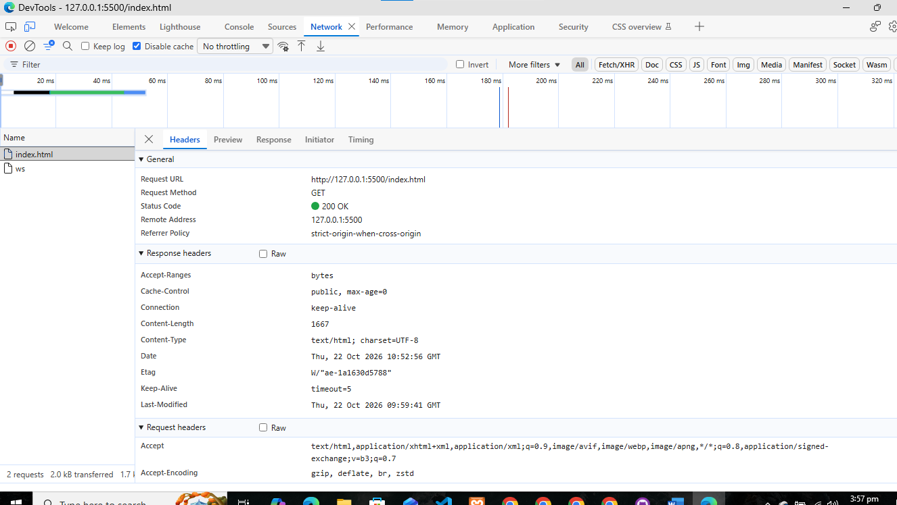
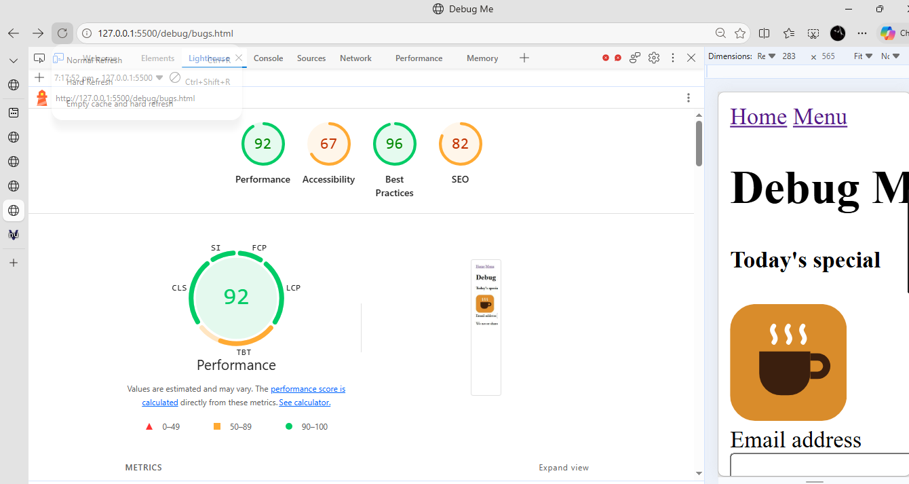
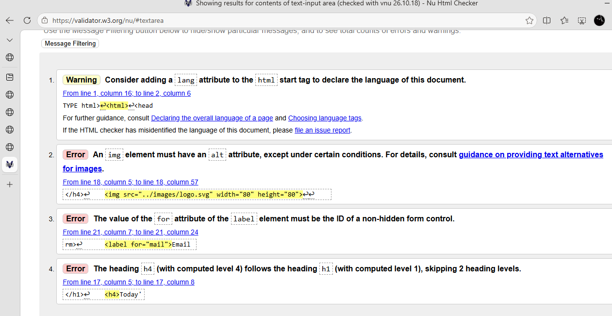

# HTTP observations (Lab 4, Task 1)

| Question | My answer |
|----------|-----------|
| Request method for index.html | GET |
| Status code with Disable cache ticked | 200 |
| Status code on a normal reload | 304 |
| Status code for /nothing-here.html | 404 |
| Value of the Content-Type response header | text/html; charset=UTF-8 |
| Remote Address (IP and port) | 127.0.0.1:5500 |
| Protocol in the address bar (http or https) | http |

## Why is this address http and not https?
HTTPS protects data while it travels across a network, so other people cannot read or change it. My traffic to 127.0.0.1 only goes to my own computer and never leaves it, so encryption is not needed here.
## Screenshot

## Specificity experiment
An id selector (#main p) beat the class selector (.hero p) even though .hero p came first in the file, because specificity is compared before order. Changing it to main p made it lose.
## Selectors I used
## Selectors I used

| Selector kind | Example from my CSS |
|---------------|---------------------|
| Element | table |
| Class | .card |
| ID | #main |
| Grouping (comma) | h1, h2, h3 |
| Descendant (space) | .nav-list a |
| Child (>) | main > section |
| Adjacent sibling (+) | h1 + p |
| Compound (no space, such as a.active) | a.active |
| Attribute | a[href^="http"] |
| Pseudo-class | a:hover |
| Pseudo-element | .menu-group h2::before |
## Bug log (Lab 4, Task 6)

| # | What was wrong (file and line) | Which tool showed it | My fix |
|---|--------------------------------|----------------------|--------|
| 1 | bugs.html line 2, the html tag had no lang attribute | Lighthouse (Internationalization) and W3C validator warning | Added lang="en" to the html tag |
| 2 | bugs.html line 7, the stylesheet link pointed to style.css but the file is bugs.css | Network tab (404) and Console MIME error | Changed href to bugs.css |
| 3 | bugs.html line 18, the img had no alt attribute | Lighthouse (Names and labels) and W3C validator error | Added a descriptive alt text |
| 4 | bugs.html line 21, label for="mail" did not match input id="email" | Lighthouse (Form elements do not have labels) and W3C validator error | Changed for to "email" |
| 5 | bugs.html line 17, the heading jumped from h1 to h4 | Lighthouse (heading order) and W3C validator error | Changed h4 to h2 |
| 6 | bugs.html, the menu links were inside a div, so there was no navigation landmark | Accessibility tree | Changed the div to nav with aria-label="Main" |
| 7 | bugs.css, .btn used the misspelled property colour | Styles pane (crossed out, warning icon) | Changed colour to color |
| 8 | bugs.css, .btn:hover had no semicolon after the background value, so the cursor line was ignored too | Styles pane | Added the semicolon |
| 9 | bugs.css, the selector .notes did not match class="note" in the HTML | Styles pane (rule never applied) | Renamed the selector to .note |
| 10 | bugs.css, .note text colour #999999 on white failed the contrast check (visible only after fixing bug 9) | Lighthouse second run | Changed the colour to #595959 |
### Evidence before fixing

images/bug-lighthouse-after.png